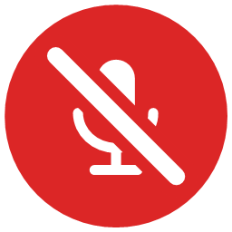
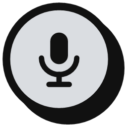

<div align="center">


# PrivacyToggle

**Kill your microphone and camera with one click or one shortcut, from the Windows tray.**


</div>

| | Live | Off | None found | Shortcut |
|---|:---:|:---:|:---:|:---:|
| 🎙️ **Microphone** |  |  |  | `Ctrl+Alt+M` |
| 📷 **Camera** |  |  |  | `Ctrl+Alt+V` |

## Features

- **System-wide mic mute.** No app (Zoom, Discord, Teams, browsers, OBS…) gets any audio while muted.
- **Real camera off.** Disables the webcam in Windows, like Device Manager does. Apps lose the picture at once and can't reopen it. If a program won't let go, PrivacyToggle tells you which one and asks before closing it.
- **Toggle or push-to-talk** for the mic, with global shortcuts that work even in fullscreen apps.
- **Enforce off.** Re-mutes a mic or re-disables a camera that something else turns back on, including headset buttons and newly plugged-in devices.
- **Per-device control.** Target all mics/cameras, or only the ones you pick.
- **Activity monitor.** See which apps are using the camera or microphone right now, plus a 24-hour timeline of every app that used them. History (7 days) stays on your PC in `%AppData%\PrivacyToggle\usage.json`.
- **Feedback:** click sounds, Windows notifications, and on-screen `MIC OFF` / `CAM OFF` badges that let clicks pass through.

## Screenshots


## Usage

- **Left-click** a tray icon to switch it. **Right-click** for both controls, Settings and Exit.
- Open **Settings** to change shortcuts, start state, devices, feedback, and which tray icons show. Changes save instantly to `%AppData%\PrivacyToggle\settings.json`.
- Launching the app again opens Settings of the running copy. `PrivacyToggle.exe --exit` closes it.

> [!NOTE]
> Camera control needs the small **PrivacyToggle Helper** service, which the installer sets up (one admin prompt). The tray app itself never runs as admin; mic control works without the service.

## 🛠️ Build

Requires the .NET 8 SDK.

```powershell
powershell -ExecutionPolicy Bypass -File build.ps1   # release build + installer
dotnet run --project src/PrivacyToggle               # dev run
```

- `publish\PrivacyToggle.exe`: self-contained single file, no .NET install needed.
- `installer\Output\PrivacyToggle-Setup-1.1.0.exe`: built if [Inno Setup 6](https://jrsoftware.org/isinfo.php) is installed. Installs the helper service, offers *Start with Windows*, and the uninstaller turns cameras back on and removes everything.
- Icons are generated by `tools\make-icons.ps1`.
